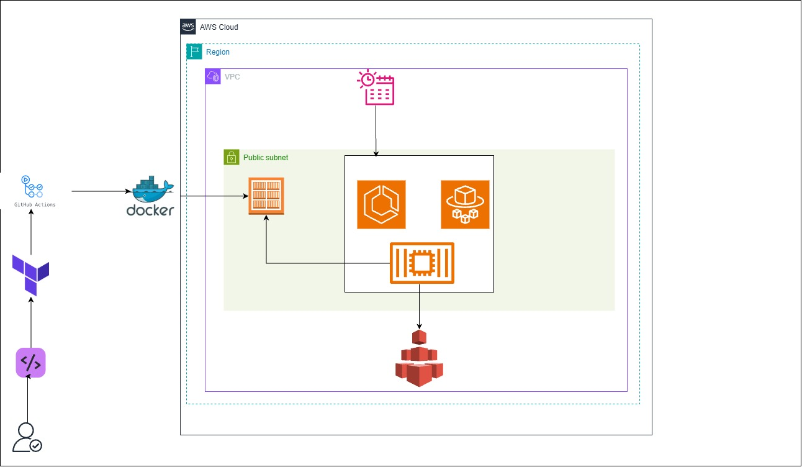

# MindFuel: Daily Quote Delivery System

MindFuel fetches an inspiring quote from the [ZenQuotes API](https://zenquotes.io/) every morning and emails it to subscribers at **7:00 AM**. It runs as a scheduled container on AWS Fargate. The infrastructure is defined in Terraform using reusable modules, and deployments run through GitHub Actions.

## Table of Contents

1. [Project Overview](#1-project-overview)
2. [Architecture](#2-architecture)
3. [Design Principles](#3-design-principles)
4. [Application Components](#4-application-components)
5. [Repository Structure](#5-repository-structure)
6. [Configuration](#6-configuration)
7. [Running Locally](#7-running-locally)
8. [Docker Image](#8-docker-image)
9. [Cloud Infrastructure](#9-cloud-infrastructure)
10. [Terraform Layout](#10-terraform-layout)
11. [First-Time Setup](#11-first-time-setup)
12. [Deploying](#12-deploying)
13. [CI/CD Pipeline](#13-cicd-pipeline)
14. [Operations Guide](#14-operations-guide)
15. [Troubleshooting](#15-troubleshooting)
16. [Security](#16-security)
17. [Cost](#17-cost)
18. [Design Decisions and Trade-offs](#18-design-decisions-and-trade-offs)
19. [Possible Improvements](#19-possible-improvements)

---

## 1. Project Overview

### Goal

Build a daily motivational quote email system that automates the whole pipeline, from fetching a quote to delivering it, with no manual steps.

### Qualities

- **Reliable:** handles failures gracefully and stays consistent.
- **Auditable:** keeps clear logs of every process and every email sent.
- **Modular:** fetching, sending and reporting each work independently.
- **Reproducible:** the whole environment can be rebuilt from code.

### How the project evolved

1. Built and tested the Python scripts locally, with SQLite and a `.env` file.
2. Ran them on a cloud server with cron (7:00 AM UTC).
3. Containerised the app with Docker.
4. Moved to AWS: ECR for the image, ECS Fargate to run it, EFS for the database, and a scheduler for the daily trigger.
5. Recreated the AWS setup as Terraform using reusable modules, with separate dev and prod environments.
6. Added a CI/CD pipeline that builds, pushes and deploys automatically.

---

## 2. Architecture


### Daily flow

1. At 07:00 Lagos time, EventBridge Scheduler starts one Fargate task.
2. ECS pulls the image from ECR, mounts the EFS volume at `/data`, and injects the email password from Secrets Manager.
3. The container runs `exec.sh`, which runs the three scripts in order.
4. The container exits. Fargate stops billing, and the data stays on EFS.

The task is a one-shot job, not a long-running service. Nothing runs between 7:00 AM and the next day.

---

## 3. Design Principles

### Separation of concerns

Three scripts each have one job. They communicate through a shared SQLite database, so any one can be replaced or upgraded without touching the others.

### Idempotence

Only one quote per day is ever stored. Running the fetcher several times in a day never creates duplicates, so a retry or a manual re-run is safe.

### Observability

Two layers of logging:

- **Log output** (files locally, CloudWatch in the cloud) for quick debugging.
- **Database records** (`email_logs`) for lasting, queryable history of every email.

### Failure isolation

One subscriber's failed email never blocks the others, and a failed admin summary never affects delivery to subscribers.

### Infrastructure as code

Everything in AWS is created by Terraform from versioned, reusable modules. Dev and prod use identical code with different settings and separate state.

---

## 4. Application Components

### 4.1 Quote Fetcher

**Purpose:** fetch a quote from the ZenQuotes API and store it.

- Checks whether a quote for today already exists, and does nothing if so.
- Otherwise fetches a new quote and validates the response before saving.
- Logs success or failure.
- Is completely independent of email operations.

### 4.2 Database (SQLite)

Stores all persistent data:

| Table | Contents |
| --- | --- |
| `quotes` | One record per day: quote text, author, date |
| `users` | Subscribers: name, email, status, frequency |
| `email_logs` | Every email sent, with delivery status and timestamp |

In the cloud the database file lives on EFS at `/data/storage.db`, so it survives between daily runs.

### 4.3 Email Sender

**Purpose:** send today's quote to all active subscribers and record each result.

- Reads SMTP credentials from environment variables.
- Connects to the mail server over SSL on port 465.
- Personalises each email with the subscriber's name.
- Logs each delivery result (success or failure) to `email_logs`.
- Retries automatically on temporary network errors.

### 4.4 Admin Summary

**Purpose:** email the admin a delivery report after all user emails are sent.

The report includes the number of users emailed, successes and failures, the quote of the day, and any error highlights. It runs separately so that a failure here never affects subscribers.

### 4.5 Entry point

`exec.sh` runs the pipeline once, in order (fetch, send, summarise), and then exits. This is what the container runs.

---

## 5. Repository Structure

```
.
├── daily-quotes-app/            # The application
│   ├── Dockerfile
│   ├── exec.sh                  # Runs the pipeline once, then exits
│   ├── requirements.txt
│   ├── scripts/                 # Fetcher, sender, admin summary
│   └── .dockerignore
├── infra/                       # Terraform, one folder per environment
│   ├── dev/
│   │   ├── main.tf
│   │   ├── variables.tf
│   │   ├── outputs.tf
│   │   └── terraform.tfvars
│   └── prod/
│       ├── main.tf
│       ├── variables.tf
│       ├── outputs.tf
│       └── terraform.tfvars
├── .github/
│   └── workflows/
│       ├── ci.yml               # Checks on pull requests
│       ├── deploy.yml           # Triggers dev then prod
│       └── deploy-env.yml       # Reusable steps for one environment
├── .gitignore
└── README.md
```

---

## 6. Configuration

The app reads these environment variables. In the cloud, Terraform sets them. Locally they come from a `.env` file, which is never committed and never baked into the image.

| Variable | Purpose | Source in the cloud |
| --- | --- | --- |
| `EMAIL_ADDRESS` | SMTP login | Plain environment variable |
| `EMAIL_SENDER` | The "from" address | Plain environment variable |
| `EMAIL_PASSWORD` | SMTP password or app password | **Secrets Manager** (injected at start) |
| `DB_PATH` | Location of the SQLite file | Plain environment variable (`/data/storage.db`) |

### Example `.env` for local use

```
EMAIL_ADDRESS=you@example.com
EMAIL_SENDER=you@example.com
EMAIL_PASSWORD=your-app-password
DB_PATH=./data/storage.db
```

> **Gmail:** use an [app password](https://support.google.com/accounts/answer/185833), not your normal account password. It requires two-step verification on the account.

---

## 7. Running Locally

### Without Docker

```bash
cd daily-quotes-app
python3 -m venv venv
source venv/bin/activate
pip install -r requirements.txt
bash exec.sh
```

### With Docker

```bash
cd daily-quotes-app
docker build --platform linux/amd64 -t mindfuel:latest .
mkdir -p data
docker run --rm \
  --env-file .env \
  -e DB_PATH=/data/storage.db \
  -v "$(pwd)/data:/data" \
  mindfuel:latest
```

The volume mount keeps the database on your machine, which mimics how EFS works in the cloud.

---

## 8. Docker Image

- **Build:** `docker build --platform linux/amd64 -t mindfuel:latest ./daily-quotes-app`
- **Architecture:** the task definition defaults to `X86_64`. If you build on an ARM machine (such as an Apple Silicon Mac), either pass `--platform linux/amd64` as above or set the task to `ARM64`. A mismatch makes the task fail instantly with `exec format error`.
- **Entry point:** must run the pipeline once and exit. A long-running process would keep the task alive and billing.
- **Secrets:** `.env` is excluded through `.dockerignore`. Credentials are never part of the image.
- **Registry:** images are pushed to ECR, in a repository named `<team>-<environment>-quotes` (for example `quotes-dev-quotes`).
- **Tags:** the pipeline tags images with the short commit SHA. Tags are immutable, so every build needs a new tag.

---

## 9. Cloud Infrastructure

| Piece | AWS service | Details |
| --- | --- | --- |
| Image registry | ECR | One repository per environment, immutable tags |
| Compute | ECS on Fargate | 1 vCPU (`cpu = 1024`), 3 GiB (`memory = 3072`), task definition only, no long-running service |
| Storage | EFS | Mounted at `/data` through an access point (uid/gid 1000, path `/sqlite-data`), encrypted in transit |
| Schedule | EventBridge Scheduler | `cron(0 7 * * ? *)`, time zone `Africa/Lagos` |
| Secrets | Secrets Manager | Holds `EMAIL_PASSWORD`, read by the ECS execution role |
| Logs | CloudWatch Logs | Group `/ecs/<team>-<environment>-quotes`, kept for 14 days |
| Network | VPC | One public subnet, internet gateway, no NAT gateway |
| Permissions | IAM | Execution role (pull image, write logs, read secrets), task role (EFS access), scheduler role (run task, pass roles) |
| Container metrics | Container Insights | Enabled on the cluster |

### Networking

The task runs in a public subnet with a public IP, so it can reach ECR, CloudWatch, Secrets Manager and the mail server without a NAT gateway. Its security group allows **no inbound traffic**; outbound is open. EFS accepts NFS (port 2049) only from the task's security group.

### Naming

Resources are named `<team>-<environment>-<name>`, for example:

| Resource | Example name |
| --- | --- |
| ECS cluster | `quotes-dev-cluster` |
| Task definition family | `quotes-dev-quotes` |
| Log group | `/ecs/quotes-dev-quotes` |
| Schedule | `quotes-dev-quotes` |
| ECR repository | `quotes-dev-quotes` |

---

## 10. Terraform Layout

### Modules

Reusable modules live in a separate repository, [AWSTerraform_Modules](https://github.com/KateChukwusom/AWSTerraform_Modules), and are pulled in by Git URL, pinned to a version tag (for example `?ref=v1.0.0`).

| Module | Creates |
| --- | --- |
| `Networking` | VPC, subnets, internet gateway, route tables, optional NAT gateways |
| `ECR` | Image repositories and lifecycle policies |
| `EFS` | File system, mount targets, access points, security group, encryption policy |
| `ECS` | Cluster, log groups, IAM roles, security groups, task definitions |
| `Scheduler` | The schedule and the role it uses to start tasks |

### Environments

`infra/dev` and `infra/prod` contain the same wiring with different settings. Each has its own `terraform.tfvars` and its own **remote state** in S3, so a change in one environment can never touch the other.

Because they are separate, a new module version can be tried in dev (`ref=v1.0.1`) while prod stays on the tested version until you choose to promote it.

### Per-environment settings (`terraform.tfvars`)

| Setting | Purpose |
| --- | --- |
| `region`, `team`, `environment` | Naming and location (`environment` must be `dev` or `prod`) |
| `vpc_cidr`, `public_subnets` | Network ranges (use different ranges for dev and prod) |
| `ecr_repositories` | Repositories to create |
| `efs_access_points` | Directory, user and permissions for the volume |
| `image_tag` | Image to run (the pipeline overrides this with the commit SHA) |
| `app_environment` | Plain environment variables |
| `app_secrets` | Map of variable name to Secrets Manager ARN |
| `schedule_expression`, `schedule_timezone` | When the job runs |
| `container_insights`, `log_retention_days` | Monitoring options |

---

## 11. First-Time Setup

Do these once, by hand, before the first deployment.

### 11.1 Terraform state bucket

Create a private, versioned, encrypted S3 bucket to store Terraform state. State files are separated per environment by key (`dev/terraform.tfstate`, `prod/terraform.tfstate`). The bucket must exist before `terraform init`.

### 11.2 Secrets Manager

For each environment, create a secret holding the email password

### 11.3 GitHub OIDC in AWS

The pipeline logs in to AWS without stored access keys.

1. In IAM, add GitHub as an OpenID Connect identity provider (`token.actions.githubusercontent.com`).
2. Create one role per environment whose trust policy allows only this repository and that environment (the subject looks like `repo:<owner>/<repo>:environment:dev`).
3. Give each role permission to manage the resources in section 9 and to read and write the state bucket.

### 11.4 GitHub environments

In the repository settings, create two environments, `dev` and `prod`:

- Add a variable `AWS_ROLE_ARN` to each, set to that environment's role ARN.
- On `prod`, enable **required reviewers**, so production deployments wait for approval.

---

## 12. Deploying

### Manually from your computer

```bash
cd infra/dev            # or infra/prod
terraform init
terraform plan
terraform apply
```
