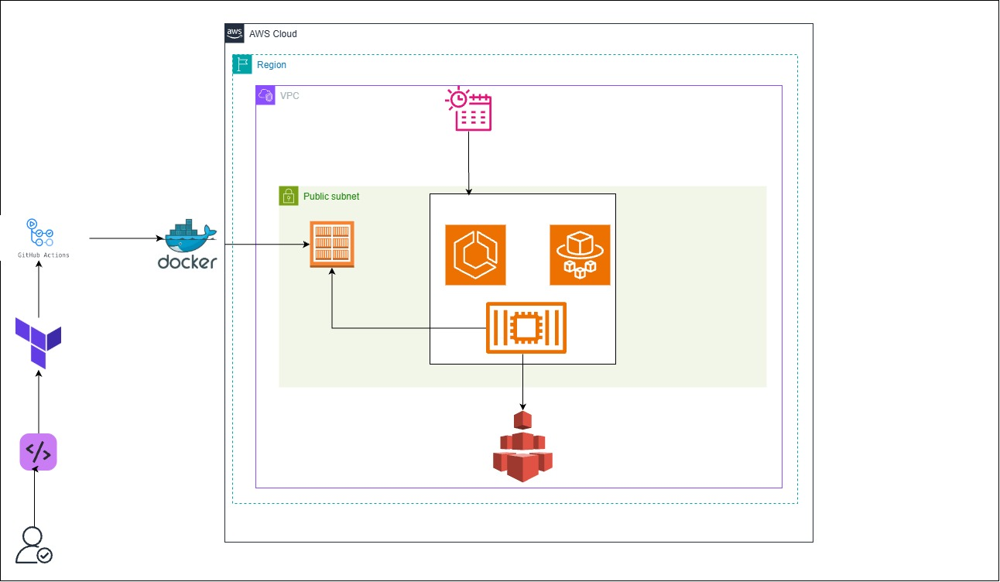

# MindFuel: Daily Quotes Mailer

Daily Quotes Mailer is a serverless application that delivers an inspirational quote by email to a list of subscribers on a defined schedule, and sends the administrator a delivery summary after each run. It is deployed on Amazon Web Services (AWS) using Terraform and GitHub Actions.

The application runs as a short-lived container that starts on schedule, completes its work, and terminates. No compute resources are provisioned between runs, which keeps operating cost low and removes the need to manage or patch servers. The infrastructure is defined entirely as code, so the system can be reproduced from this repository.

## Key features

- **Serverless execution.** AWS Fargate runs the container only when the schedule triggers it. The design uses no NAT gateway, load balancer, or always-on server.
- **Infrastructure as code.** The network, storage, permissions, and scheduling are provisioned with Terraform, using six reusable modules maintained in separate repositories and pinned to version tags.
- **Automated delivery pipeline.** A single GitHub Actions workflow validates every pull request, then builds, deploys, and test-runs the application after merge, first to the development environment and then to production.
- **Credential-free authentication.** GitHub authenticates to AWS through OpenID Connect (OIDC) using short-lived tokens, so no long-lived access keys are stored.
- **Controlled releases.** Changes reach the main branch only through reviewed pull requests, and production deployments require a separate approval.
- **Idempotent delivery.** The subscriber database is stored on Amazon EFS, and the scripts skip any recipient who has already been emailed that day, so repeated runs do not produce duplicate messages.

## Table of Contents

1. [Project Overview](#1-project-overview)
2. [Architecture](#2-architecture)
3. [Design Principles](#3-design-principles)
4. [Application Components](#4-application-components)
5. [Repository Structure](#5-repository-structure)
6. [Configuration](#6-configuration)
7. [Running Locally](#7-running-locally)
8. [Docker Image](#8-docker-image)
9. [Cloud Infrastructure](#9-cloud-infrastructure)
10. [Terraform Layout](#10-terraform-layout)
11. [First-Time Setup](#11-first-time-setup)
12. [Deploying](#12-deploying)

---

## 1. Project Overview

### Goal

Build a daily motivational quote email system that automates the whole pipeline, from fetching a quote to delivering it, with no manual steps.

### Qualities

- **Reliable:** handles failures gracefully and stays consistent.
- **Auditable:** keeps clear logs of every process and every email sent.
- **Modular:** fetching, sending and reporting each work independently.
- **Reproducible:** the whole environment can be rebuilt from code.

### How the project evolved

1. Built and tested the Python scripts locally, with SQLite and a `.env` file.
2. Ran them on a cloud server with cron (7:00 AM UTC).
3. Containerised the app with Docker.
4. Moved to AWS: ECR for the image, ECS Fargate to run it, EFS for the database, and a scheduler for the daily trigger.
5. Recreated the AWS setup as Terraform using reusable modules, with separate dev and prod environments.
6. Added a CI/CD pipeline that builds, pushes and deploys automatically.

---

## 2. Architecture


### Daily flow

1. At 07:00 Lagos time, EventBridge Scheduler starts one Fargate task.
2. ECS pulls the image from ECR, mounts the EFS volume at `/data`, and injects the email password from Secrets Manager.
3. The container runs `exec.sh`, which runs the three scripts in order.
4. The container exits. Fargate stops billing, and the data stays on EFS.

The task is a one-shot job, not a long-running service. Nothing runs between 7:00 AM and the next day.

---

## 3. Design Principles

### Separation of concerns

Three scripts each have one job. They communicate through a shared SQLite database, so any one can be replaced or upgraded without touching the others.

### Idempotence

Only one quote per day is ever stored. Running the fetcher several times in a day never creates duplicates, so a retry or a manual re-run is safe.

### Observability

Two layers of logging:

- **Log output** (files locally, CloudWatch in the cloud) for quick debugging.
- **Database records** (`email_logs`) for lasting, queryable history of every email.

### Failure isolation

One subscriber's failed email never blocks the others, and a failed admin summary never affects delivery to subscribers.

### Infrastructure as code

Everything in AWS is created by Terraform from versioned, reusable modules. Dev and prod use identical code with different settings and separate state.

---

## 4. Application Components

### 4.1 Quote Fetcher

**Purpose:** fetch a quote from the ZenQuotes API and store it.

- Checks whether a quote for today already exists, and does nothing if so.
- Otherwise fetches a new quote and validates the response before saving.
- Logs success or failure.
- Is completely independent of email operations.

### 4.2 Database (SQLite)

Stores all persistent data:

| Table | Contents |
| --- | --- |
| `quotes` | One record per day: quote text, author, date |
| `users` | Subscribers: name, email, status, frequency |
| `email_logs` | Every email sent, with delivery status and timestamp |

In the cloud the database file lives on EFS at `/data/storage.db`, so it survives between daily runs.

### 4.3 Email Sender

**Purpose:** send today's quote to all active subscribers and record each result.

- Reads SMTP credentials from environment variables.
- Connects to the mail server over SSL on port 465.
- Personalises each email with the subscriber's name.
- Logs each delivery result (success or failure) to `email_logs`.
- Retries automatically on temporary network errors.

### 4.4 Admin Summary

**Purpose:** email the admin a delivery report after all user emails are sent.

The report includes the number of users emailed, successes and failures, the quote of the day, and any error highlights. It runs separately so that a failure here never affects subscribers.

### 4.5 Entry point

`exec.sh` runs the pipeline once, in order (fetch, send, summarise), and then exits. This is what the container runs.

---

## 5. Repository Structure

```
Dailyquotes/
├── .github/
│   └── workflows/
│       └── pipeline.yml        
├── daily-quotes-app/           
│   ├── Dockerfile
│   ├── exec.sh                 
│   ├── requirements.txt
│   └── scripts/
│       ├── setup_db.py         
│       ├── quotefetcher.py     
│       ├── emailsender.py      
│       ├── adminsummary.py     
│       └── users.csv           
├── infra/                      
│   ├── dev/                    
│   │   ├── backend.tf
│   │   ├── main.tf
│   │   ├── outputs.tf
│   │   ├── terraform.tfvars
│   │   └── variables.tf
│   └── prod/                   
├── image/
│   └── architecture.png        
└── README.md
```

## 6. Configuration

The app reads these environment variables. In the cloud, Terraform sets them. Locally they come from a `.env` file, which is never committed and never baked into the image.

| Variable | Purpose | Source in the cloud |
| --- | --- | --- |
| `EMAIL_ADDRESS` | SMTP login | Plain environment variable |
| `ADMIN_EMAIL_ADDRESS` | The "admin" address | Plain environment variable |
| `EMAIL_PASSWORD` | SMTP password or app password | Secrets Manager (injected at start) |
| `DB_PATH` | Location of the SQLite file | Plain environment variable (`/data/storage.db`) |

### Example `.env` for local use

```
EMAIL_ADDRESS=you@example.com
ADMIN_EMAIL_ADDRESS=you@example.com
EMAIL_PASSWORD=your-app-password
DB_PATH=./data/storage.db
```

**Gmail:** use an app password, not your normal account password. It requires two-step verification on the account.

---

## 7. Running Locally

### Without Docker

```bash
cd daily-quotes-app
python3 -m venv venv
source venv/bin/activate
pip install -r requirements.txt
bash exec.sh
```

### With Docker

```bash
cd daily-quotes-app
docker build --platform linux/amd64 -t mindfuel:latest .
mkdir -p data
docker run --rm \
  --env-file .env \
  -e DB_PATH=/data/storage.db \
  -v "$(pwd)/data:/data" \
  mindfuel:latest
```

The volume mount keeps the database on your machine, which mimics how EFS works in the cloud.

---

## 8. Docker Image

- **Build:** `docker build --platform linux/amd64 -t mindfuel:latest ./daily-quotes-app`
- **Architecture:** the task definition defaults to `X86_64`. If you build on an ARM machine (such as an Apple Silicon Mac), either pass `--platform linux/amd64` as above or set the task to `ARM64`. A mismatch makes the task fail instantly with `exec format error`.
- **Entry point:** must run the pipeline once and exit. A long-running process would keep the task alive and billing.
- **Secrets:** `.env` is excluded through `.dockerignore`. Credentials are never part of the image.
- **Registry:** images are pushed to ECR, in a repository named `<team>-<environment>-quotes` (for example `quotes-dev-quotes`).
- **Tags:** the pipeline tags images with the short commit SHA. Tags are immutable, so every build needs a new tag.

---

## 9. Cloud Infrastructure

| Piece | AWS service | Details |
| --- | --- | --- |
| Image registry | ECR | One repository per environment, immutable tags |
| Compute | ECS on Fargate | 1 vCPU (`cpu = 1024`), 3 GiB (`memory = 3072`), task definition only, no long-running service |
| Storage | EFS | Mounted at `/data` through an access point (uid/gid 1000, path `/sqlite-data`), encrypted in transit |
| Schedule | EventBridge Scheduler | `cron(0 7 * * ? *)`, time zone `Africa/Lagos` |
| Secrets | Secrets Manager | Holds `EMAIL_PASSWORD`, read by the ECS execution role |
| Logs | CloudWatch Logs | Group `/ecs/<team>-<environment>-quotes`, kept for 14 days |
| Network | VPC | One public subnet, internet gateway, no NAT gateway |
| Permissions | IAM | Execution role (pull image, write logs, read secrets), task role (EFS access), scheduler role (run task, pass roles) |
| Container metrics | Container Insights | Enabled on the cluster |

### Networking

The task runs in a public subnet with a public IP, so it can reach ECR, CloudWatch, Secrets Manager and the mail server without a NAT gateway. Its security group allows no inbound traffic; outbound is open. EFS accepts NFS (port 2049) only from the task's security group.

### Naming

Resources are named `<team>-<environment>-<name>`, for example:

| Resource | Example name |
| --- | --- |
| ECS cluster | `quotes-dev-cluster` |
| Task definition family | `quotes-dev-quotes` |
| Log group | `/ecs/quotes-dev-quotes` |
| Schedule | `quotes-dev-quotes` |
| ECR repository | `quotes-dev-quotes` |

---

## 10. Terraform Layout

### Modules

Each Terraform module lives in its own repository and is pulled at a pinned tag:

| Module | Repository |
| --- | --- |
| IAM | `github.com/KateChukwusom/cob-terraform-aws-iam` |
| Networking | `github.com/KateChukwusom/cob-terraform-aws-networking` |
| ECR | `github.com/KateChukwusom/cob-terraform-aws-ecr` |
| EFS | `github.com/KateChukwusom/cob-terraform-aws-efs` |
| ECS | `github.com/KateChukwusom/cob-terraform-aws-ecs` |
| Scheduler | `github.com/KateChukwusom/cob-terraform-aws-scheduler` |

### Environments

`infra/dev` and `infra/prod` contain the same wiring with different settings. Each has its own `terraform.tfvars` and its own remote state in S3, so a change in one environment can never touch the other.

Because they are separate, a new module version can be tried in dev (`ref=v1.0.1`) while prod stays on the tested version it is promoted.

### Per-environment settings (`terraform.tfvars`)

| Setting | Purpose |
| --- | --- |
| `region`, `team`, `environment` | Naming and location (`environment` must be `dev` or `prod`) |
| `vpc_cidr`, `public_subnets` | Network ranges (use different ranges for dev and prod) |
| `ecr_repositories` | Repositories to create |
| `efs_access_points` | Directory, user and permissions for the volume |
| `image_tag` | Image to run (the pipeline overrides this with the commit SHA) |
| `app_environment` | Plain environment variables |
| `app_secrets` | Map of variable name to Secrets Manager ARN |
| `schedule_expression`, `schedule_timezone` | When the job runs |
| `container_insights`, `log_retention_days` | Monitoring options |

---

## 11. First-Time Setup

## Prerequisites

| Tool / account | Notes |
| --- | --- |
| AWS account | You need permission to create IAM, S3, ECS, EFS, VPC and related resources |
| GitHub account and repo | Public repo recommended |
| Terraform `>= 1.10` | Needed for S3 native state locking |
| AWS CLI v2 | Logged in to your account |
| Docker | Only for local testing |
| Gmail account with 2-step verification | To create an app password |
| A second GitHub user | to approve pull requests and prod deployments |

Throughout this guide, replace:

| Placeholder | Meaning |
| --- | --- |
| `<ACCOUNT_ID>` | Your 12-digit AWS account ID |
| `<GITHUB_USER>/<REPO>` | Your GitHub owner and repository name |
| `<STATE_BUCKET>` | Your state bucket name, for example `quotemail-tfstate-<ACCOUNT_ID>` |
| `<DEPLOY_ROLE>` | Name of the role GitHub assumes, for example `quotemail-github-deploy` |

### 11.1 Terraform state bucket

Create a private, versioned, encrypted S3 bucket to store Terraform state. State files are separated per environment by key (`dev/terraform.tfstate`, `prod/terraform.tfstate`). The bucket must exist before `terraform init`.

Set the backend in `infra/dev/backend.tf` (backend blocks cannot use variables):

```hcl
terraform {
  backend "s3" {
    bucket       = "<STATE_BUCKET>"
    key          = "quotemail/dev/terraform.tfstate"
    region       = "us-east-1"
    encrypt      = true
    use_lockfile = true
  }
}
```

`infra/prod/backend.tf` is identical except `key = "quotemail/prod/terraform.tfstate"`.

### 11.2 Secrets Manager

1. In your Google account, create an app password (myaccount.google.com/apppasswords). Remove the spaces so it is 16 characters.
2. Store it as a plain string, not JSON.
For each environment, create a secret holding the email password

### 11.3 GitHub OIDC in AWS

**3a. Add the identity provider** (once per AWS account). In the AWS console go to IAM, Identity providers, Add provider:

- Provider type: OpenID Connect
- Provider URL: `https://token.actions.githubusercontent.com`
- Audience: `sts.amazonaws.com`

If `token.actions.githubusercontent.com` is already listed, skip this.

**3b. Create the role** named `<DEPLOY_ROLE>` with this trust policy. The `sub` values restrict login to your repo's `dev` and `prod` environments only:

```json
{
  "Version": "2012-10-17",
  "Statement": [{
    "Effect": "Allow",
    "Principal": {
      "Federated": "arn:aws:iam::<ACCOUNT_ID>:oidc-provider/token.actions.githubusercontent.com"
    },
    "Action": "sts:AssumeRoleWithWebIdentity",
    "Condition": {
      "StringEquals": {
        "token.actions.githubusercontent.com:aud": "sts.amazonaws.com",
        "token.actions.githubusercontent.com:sub": [
          "repo:<GITHUB_USER>/<REPO>:environment:dev",
          "repo:<GITHUB_USER>/<REPO>:environment:prod"
        ]
      }
    }
  }]
}
```

The `environment:` form is required because the deploy job declares `environment: dev|prod`. A `ref:refs/heads/main` subject will not match.

**3c. Attach permissions** to the role:

1. The AWS managed policy `PowerUserAccess` (covers everything except IAM).
2. An inline policy that allows IAM only for this project's resource names:

```json
{
  "Version": "2012-10-17",
  "Statement": [
    {
      "Effect": "Allow",
      "Action": "iam:*",
      "Resource": [
        "arn:aws:iam::<ACCOUNT_ID>:role/quotemail-*",
        "arn:aws:iam::<ACCOUNT_ID>:policy/quotemail-*",
        "arn:aws:iam::<ACCOUNT_ID>:instance-profile/quotemail-*"
      ]
    },
    {
      "Effect": "Allow",
      "Action": ["iam:ListPolicies", "iam:ListRoles"],
      "Resource": "*"
    }
  ]
}
```

The scope must match your `team` name. If you change `team`, change the `quotemail-*` prefix here too. PowerUserAccess is broad; for real production use, narrow it to the services this project uses.

### 11.4 GitHub environments

In the repository settings, create two environments, `dev` and `prod`:

- Add a variable `AWS_ROLE_ARN` to each, set to that environment's role ARN.
- On `prod`, enable **required reviewers**, so production deployments wait for approval.

---

### Configure GitHub

In your repo's Settings:

1. **Secrets and variables, Actions, Variables:** add `AWS_ROLE_ARN` = `arn:aws:iam::<ACCOUNT_ID>:role/<DEPLOY_ROLE>` (a variable, not a secret; the ARN is an identifier, not a credential).
2. **Environments:** create `dev` (no protection) and `prod`. On `prod`:
   - tick **Required reviewers** and add your approver, then click **Save protection rules**
   - tick **Prevent self-review**
   - under **Deployment branches and tags**, choose Selected branches and add `main`
3. **Collaborators:** add your reviewer(s). Reviewers need Write access and must accept the invite.
4. **Rules, Rulesets, New branch ruleset:** target the default branch, enable **Require a pull request before merging** (1 approval) and **Block force pushes**. Add `Pipeline / check` as a required status check after CI has run once.

## 12. Deploying

### Configure Terraform

Edit `infra/dev/terraform.tfvars` (and `infra/prod/terraform.tfvars`, with `environment = "prod"`)

## First deploy

1. Create a branch, commit, push, and open a pull request.
2. Wait for the `check` job to go green and have your reviewer approve.
3. Merge. The pipeline deploys **dev**, then waits for approval, then deploys **prod**.

The first run creates everything from scratch, so it takes several minutes (the EFS mount target alone can take 1 to 3 minutes).

## How the pipeline works

One file, `.github/workflows/pipeline.yml`, with two jobs:

| Job | Runs on | What it does |
| --- | --- | --- |
| `check` (CI) | Pull requests | `terraform fmt -check`, `terraform init -backend=false` and `validate` for dev and prod, Docker build (no push). No AWS login. |
| `deploy` (CD) | Merge to `main`, or manual run | For dev, then prod: log in to AWS via OIDC, create the ECR repo, build and push the image tagged with the short commit ID, `terraform plan`, `terraform apply`, then run the task once and fail if its exit code is not 0 |

Key design points:

- **No stored AWS keys.** GitHub requests a short-lived token; AWS checks it against the role's trust policy.
- **Immutable image tags.** Every image is tagged with the commit ID, and the push is skipped if that tag already exists.
- **README-only changes do not trigger anything.** The workflow only runs for changes under `daily-quotes-app/`, `infra/` or the workflow file itself.
- **Two approval gates.** A reviewer must approve the pull request before merge, and the `prod` environment requires a reviewer to approve the deployment

`main` is protected. Every change goes through a branch and a pull request.

```bash
cd <repo>
git checkout main
git pull
git checkout -b my-change

# ...edit files...
terraform fmt -recursive        # run inside infra/

git add -A
git commit -m "Describe the change"
git push -u origin my-change
```

Then:

1. Open a pull request on GitHub.
2. Wait for `Pipeline / check` to pass.
3. A reviewer approves.
4. Merge. Dev deploys automatically; approve the prod deployment under **Actions, the run, Review deployments**.

Changing only the app (`daily-quotes-app/`) rebuilds the image and redeploys with the new tag. Changing infrastructure runs `terraform apply`.

```bash

### Manually from your computer

```bash
cd infra/dev           
terraform init
terraform plan
terraform apply
```

## Contributing

Contributions are welcome, whether it is a bug fix, a documentation improvement or a new idea.
